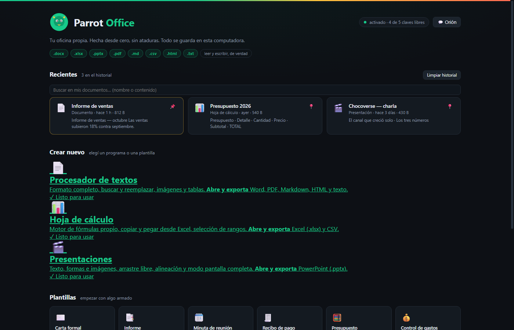
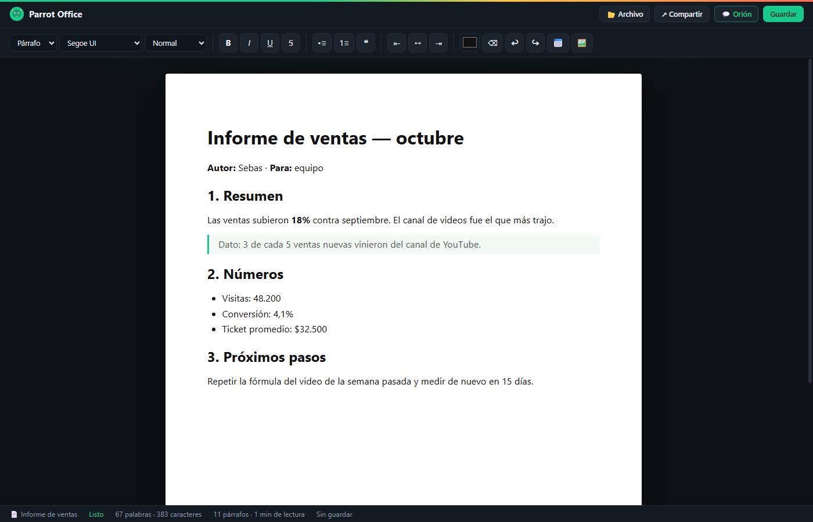
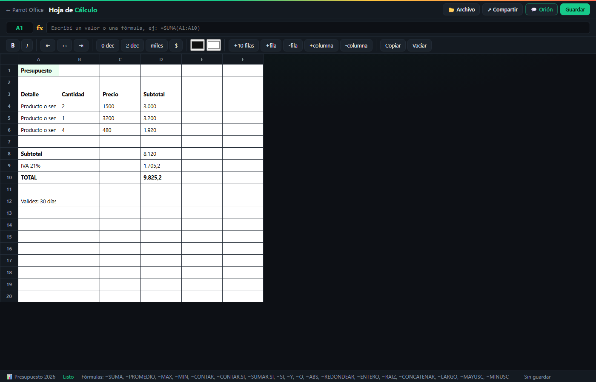
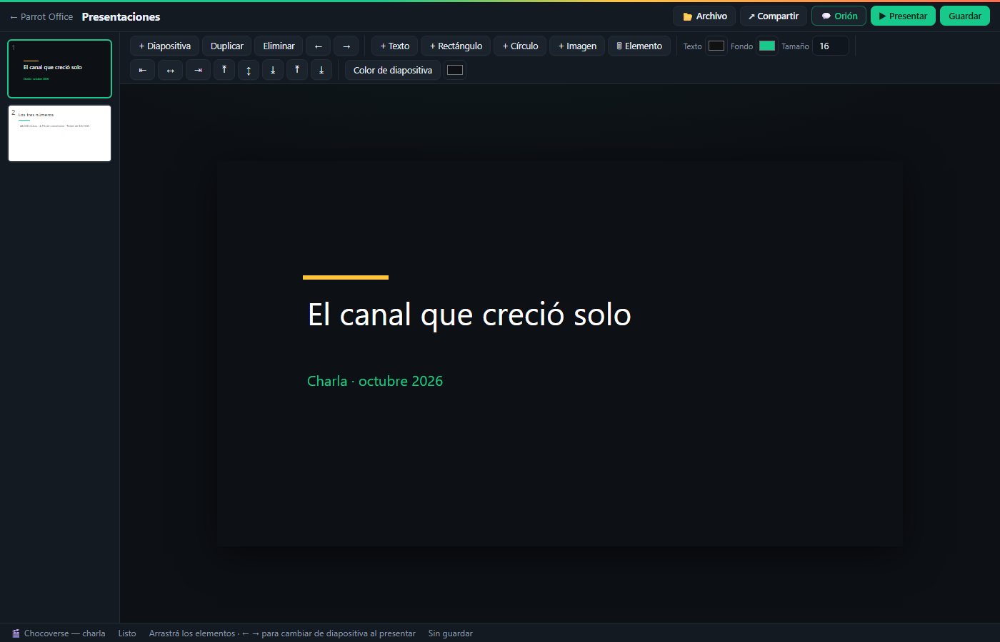
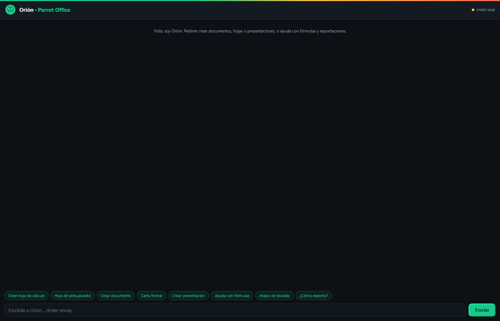
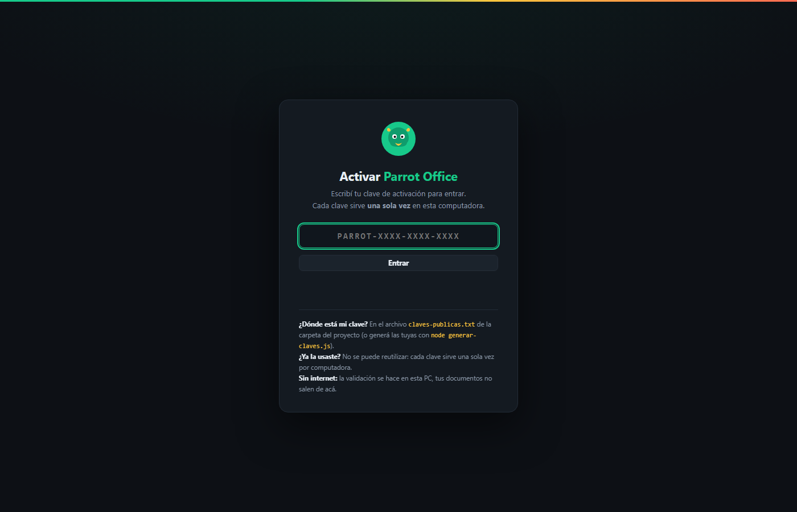

<div align="center">



# Parrot Office

**Your own office suite. Built from scratch. No strings attached.**

Word processor · Spreadsheet · Presentations — with **real** `.docx` / `.xlsx` / `.pptx` files,
100% original code, zero dependencies, works offline.

[](LICENSE)
[](#how-it-works)
[](#install)
[](#install)

English · [Español](LEEME.md)

</div>

---

## What is Parrot Office?

A complete office suite that runs **entirely on your computer**. No account, no cloud,
no internet connection, no installed libraries — just HTML, CSS and vanilla JavaScript
you can read in an afternoon.

It doesn't wrap Office or LibreOffice: the `.docx`, `.xlsx` and `.pptx` files are
**real OOXML packages** built by Parrot Office itself (own ZIP writer with CRC32, own
`deflate`/`zlib` inflate for *reading* files made by Word, Excel and PowerPoint).

Everything you create is saved on your own machine (`localStorage`), with an
Office-style history of recent documents, 15 templates, find & replace, a formula
engine written from scratch, and a built-in assistant (**Orión**) you can ask
*"create a spreadsheet with a budget"* — and it really creates it.

---

## Screenshots

| | |
|---|---|
|  |  |
| **Procesador de textos** — format, find & replace, images, tables | **Hoja de cálculo** — own formula engine, live recalculation |
|  |  |
| **Presentaciones** — drag & drop, alignment, fullscreen mode | **Orión** — built-in chat that creates documents for you |
|  | |
| **Activación** — one-time keys, validated on your own PC | |

---

## Install

### Windows (recommended)

Download or clone the repo, then double-click `index.html`. Done.

To get a real desktop app (own window, no browser bars) that also starts the
Orión chat server automatically:

```powershell
powershell -ExecutionPolicy Bypass -File instalar.ps1
```

That creates the **Parrot Office** shortcut on your desktop (and in the Start menu).
Nothing is copied or moved — it works straight from the folder.

### macOS / Linux

Open `index.html` in Chrome, Edge or Firefox. That's the whole install.

Optional (only for the full Orión chat, see below):

```bash
node parrot-chat.js
```

### Requirements

- Any modern browser (Chrome / Edge recommended)
- Optional: [Node.js](https://nodejs.org) 18+ — only for the full Orión chat server.
  Without it, the chat still works in **local mode** (creates documents from
  templates, explains formulas and shortcuts).
- No npm packages. Ever.

---

## Activation keys

The first time it opens, Parrot Office asks for a one-time activation key
(`PARROT-XXXX-XXXX-XXXX`). Five public keys ship in
[`claves-publicas.txt`](claves-publicas.txt); **each one works once per computer**.

- The code only stores the **SHA-256 hash** of each key (hand-verified against
  Python's `hashlib`) — the key itself is never in the source.
- 5 failed attempts → 30-second lockout.
- Fully offline: validation happens on your own PC.

**Honest note:** this is a door lock, not a safe. Since everything is validated
locally, someone who knows computers could bypass it. For something serious you'd
need a server validating the keys.

Want your own keys? 

```bash
node generar-claves.js 5
```

It prints 5 fresh keys plus the `HASHES` block ready to paste into `oficina-claves.js`.

---

## What's inside

### 📄 Procesador de textos
- Full formatting: bold, italic, underline, strikethrough, lists, quotes, alignment,
  5 fonts, 6 sizes, text color (`Ctrl+B/I/U` included)
- **Find & replace** (`Ctrl+F` / `Ctrl+H`): highlights matches, jump between them
  (`F3` / `↑↓`), replace all at once
- Open & export: **Word (.docx)**, PDF (print dialog), HTML, Markdown, TXT
- Insert images and today's date, live word/character/paragraph/reading-time count
- Editable document name, autosave every 10 s

### 📊 Hoja de cálculo
- **Own formula engine** (tokenizer → parser → evaluator): `+ - * / ^ %`,
  comparisons, cell refs and ranges, live recalculation
- Functions: `SUMA`, `PROMEDIO`, `MAX`, `MIN`, `CONTAR`, `CONTAR.SI`, `SUMAR.SI`,
  `SI`, `Y`, `O`, `NO`, `ABS`, `REDONDEAR`, `ENTERO`, `RAIZ`, `CONCATENAR`, `LARGO`,
  `MAYUSC`, `MINUSC`
- Cycle detection (`#CICLO!`) and error values (`#DIV/0!`, `#REF!`, `#VALOR!`)
- Range selection (shift+click) with sum & count in the status bar
- **Copy (Ctrl+C) and paste from Excel (Ctrl+V)** — real tab-separated data
- Per-cell bold/italic/alignment, decimals, thousands separator, currency,
  text & background colors · add/remove rows and columns
- Import CSV · export CSV, HTML and **real .xlsx with live formulas**

### 🎬 Presentaciones
- 16:9 slides with thumbnails: add / duplicate / delete / reorder (← →)
- Text boxes, rectangles, circles and **images** — draggable, resizable
- Element alignment (6 modes) and z-order (front / back)
- Fullscreen present mode (← → to navigate, Esc to exit)
- Export **real .pptx** (texts, shapes and images at original positions),
  a single-file navigable HTML, or a Parrot `.json` backup

### 🏠 Start menu (`index.html`)
- **Recents**: everything you saved or opened — name, date, size, content preview,
  pin to top (📌), search by name or content
- **Create new**: 3 programs + **15 templates** (formal letter, report, meeting
  minutes, receipt, budget, expense tracker, inventory, contact list, cover slide,
  title & content, two columns, closing…)
- Quick access: open a file from your PC (routes to the right program), import CSV,
  activate another key, keyboard shortcuts, about

### 📂 Centralized File menu + sharing
One **📂 Archivo** button per app gathers: New (with templates), Open, Save,
**Import** (every readable format), **Export** (every format, with a description of
each) and Print. Next to it, **↗ Compartir**:
- **WhatsApp** — opens the chat with the text
- **Email** — opens your mail program
- **Clipboard** — copy the text
- **Download** — the real `.docx` / `.xlsx` / `.pptx`, double-click to open in
  Word / Excel / PowerPoint
- **System share** — when the browser allows it

### 💬 Orión (built-in assistant)
A 💬 button on every screen opens a chat popup. Ask for help — or directly
*"crear una hoja de cálculo con presupuesto"* — and Orión replies **and creates the
document for real** (the button appears; one click and it's open).

- **Local mode** (no server needed): understands the basics — create documents,
  sheets and presentations from templates, explain formulas, shortcuts, exports.
- **Full mode**: `node parrot-chat.js` (port 8790) forwards to your local
  OpenRouter-compatible proxy with the API key from the `OPENROUTER_API_KEY`
  environment variable (or a `parrot-chat.key` file). The system prompt forces an
  `[ACCION] {"app":…,"plantilla":…}` line the popup parses to build the document.

---

## Formats

| Format | Read | Write |
|---|---|---|
| `.docx` (Word) | ✓ | ✓ |
| `.xlsx` (Excel) | ✓ | ✓ |
| `.pptx` (PowerPoint) | ✓ | ✓ |
| `.pdf` | ✓ (text) | ✓ (print) |
| `.md` / `.html` / `.txt` | ✓ | ✓ |
| `.csv` | ✓ | ✓ |
| `.json` (Parrot backup) | ✓ | ✓ |

Reading real files uses `oficina-leer.js` + `oficina-inflate.js` — an inflate
(`deflate`/`zlib`) written from scratch. No internet, no libraries: it opens the
files Word, Excel and PowerPoint actually produce (verified against python-docx,
openpyxl and python-pptx).

---

## How it works

```
index.html            start menu: recents, templates, quick access
activar.html          activation gate (one-time keys)
procesador.html       word processor
hoja.html             spreadsheet + own formula engine
presentaciones.html   presentations editor
chat.html             Orión chat popup
oficina-claves.js     SHA-256 + one-time key validation
oficina-historial.js  Office-style recents (localStorage)
oficina-plantillas.js the 15 templates
oficina-menu.js       centralized Archivo menu + Compartir sheet
oficina-tema.css      shared dark "parrot" theme
oficina-zip.js        ZIP writer (store) + CRC32
oficina-inflate.js    inflate (RFC 1951) + zlib (RFC 1950), from scratch
oficina-leer.js       DOCX/XLSX/PPTX/PDF readers (real files)
oficina-docx.js       HTML → real .docx
oficina-xlsx.js       sheet → real .xlsx (live formulas)
oficina-pptx.js       slides → real .pptx
parrot-chat.js        Orión chat server (optional, Node)
generar-claves.js     key generator (Node)
pruebas/              browser test harnesses (see below)
```

Design decisions worth knowing:
- **Vanilla JS modules over `localStorage`**: your data never leaves the machine.
- **OOXML from scratch**: `oficina-zip.js` writes the container, the three exporters
  build the XML parts. Verified with the official Python libraries.
- **The PDF reader** decodes each stream by its real `/Filter` (`FlateDecode`,
  `ASCII85Decode`, `ASCIIHexDecode`) and maps character codes with the `ToUnicode`
  CMap **of the font active at that moment** (`/Fx N Tf`). Mixing maps from several
  fonts shifts the symbols; this doesn't.
- **The chat** degrades gracefully: server down → local mode, never a dead button.

---

## Tests

Everything is verified in a real browser (headless Chrome) — no framework, no npm:

```bash
# 1. export + round-trip + keys + history + templates + zip + inflate
#    open pruebas/arnes.html and read the results on the page
# 2. read REAL files made by python-docx / openpyxl / python-pptx
#    open pruebas/arnes-lector.html and read the results on the page
```

`pruebas/archivos/` holds the real fixtures used by the reader harness.

Current status (v2.1, October 2026): **all tests green** —
44/44 formula-engine cases (arithmetic, precedence, comparisons, functions, ranges,
cycles, Spanish number formats, aggregates ignoring text), 11/11 browser harness
checks, real-file reading for docx/xlsx/pptx, and the three generated files
re-open cleanly in python-docx, openpyxl and python-pptx.

---

## FAQ

**Does it really open in Word / Excel / PowerPoint?**
Yes. The files are standard OOXML. We verify every release by re-opening the
generated files with python-docx, openpyxl and python-pptx.

**Where are my documents saved?**
In your browser's storage for the app, on your own PC. Export to `.docx` / `.xlsx` /
`.pptx` to get files you can open anywhere.

**Which browser?**
Chrome or Edge recommended. Firefox works too. The desktop shortcut uses Chrome in
app mode with its own profile.

**Can I use it on my phone?**
The layout adapts, but it's designed for desktop.

**Is the activation a paywall?**
No. It's a door lock so the suite feels like a product. Five public keys ship with
the repo and `generar-claves.js` makes as many as you want.

**What about the Orión chat?**
Local mode works with zero setup. Full mode needs Node and an OpenRouter-compatible
API key in the environment (or a `parrot-chat.key` file next to the server).

---

## Roadmap

- [ ] Desktop build with Electron / Tauri
- [ ] Sync documents between your PCs
- [ ] More templates

---

## License

[MIT](LICENSE) — do whatever you want with it. If you build something cool, a
shout-out is appreciated.

---

<div align="center">

**Parrot Office** — código 100% original, escrito desde cero.
Documentación en español: [LEEME.md](LEEME.md)

</div>
